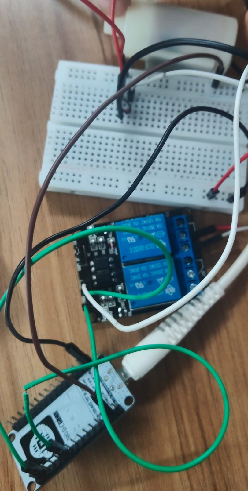
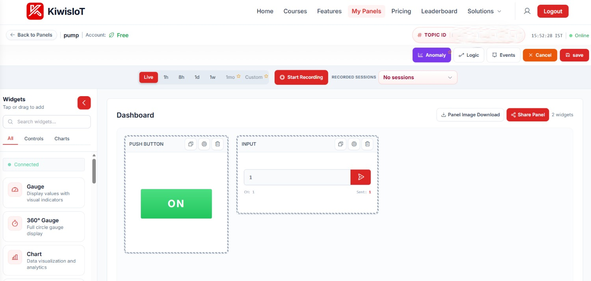

# Water-Pump-control-System-using-KiwisIoT-Platform
# Project Overview
The KiwisIoT Smart Water Pump Control System is an IoT-based project that allows users to remotely control a water pump using the KiwisIoT platform.
The system uses an ESP8266 NodeMCU and a relay module to control the water pump through voice commands and text input from the KiwisIoT dashboard.
# Components Required
- ESP8266 NodeMCU
- 1-Channel Relay Module
- 5V DC Water Pump
- Jumper Wires
- Power Supply
- Wi-Fi Connection
# Working Principle
1. ESP8266 connects to the Wi-Fi network.
2. KiwisIoT establishes communication with the NodeMCU.
3. The user sends commands through the KiwisIoT dashboard.
4. When the user enters "1" or says "Turn on motor", the relay activates.
5. When the user enters "0" or says "Turn off motor", the relay deactivates.
6. The water pump switches ON or OFF according to the received command.
# Software Requirements
- Arduino IDE
- ESP8266 Board Package
- ESP8266WiFi Library
- KiwisIoT Library
# Project images

# Source code
[View code](pump.ino)
# Platform
*IoT platform:*[KiwisIoT](https://kiwisiot.in)
# Applications
- Smart irrigation systems
- Remote water management
- Smart home automation
- IoT-based pump monitoring and control

📜 License

This project is created for educational and learning purposes.
